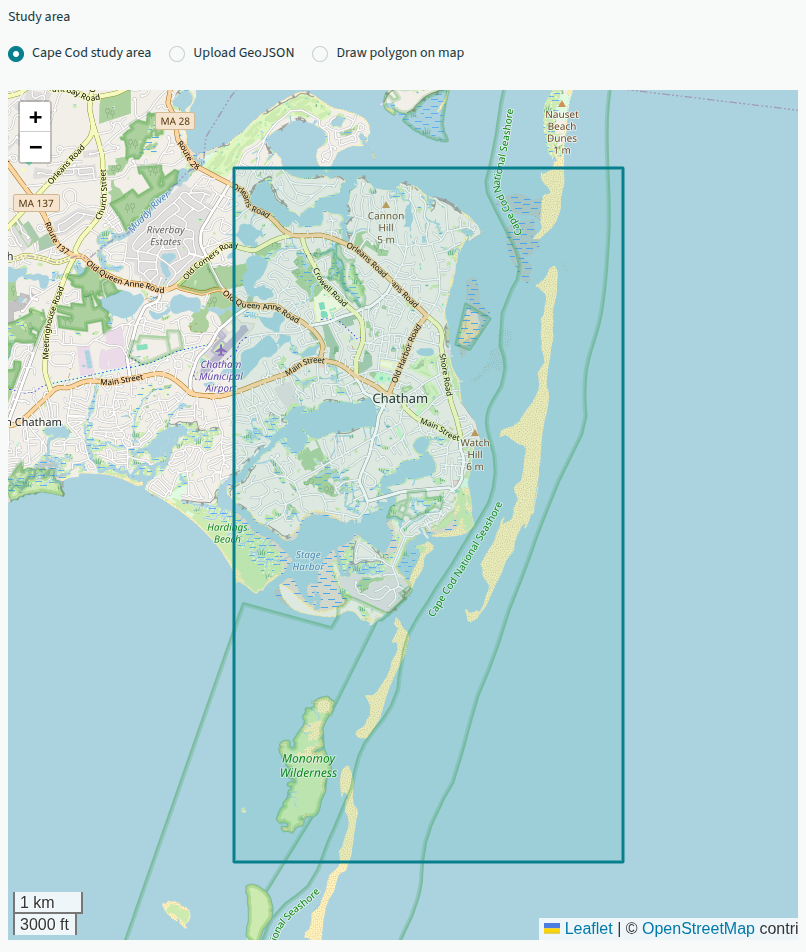
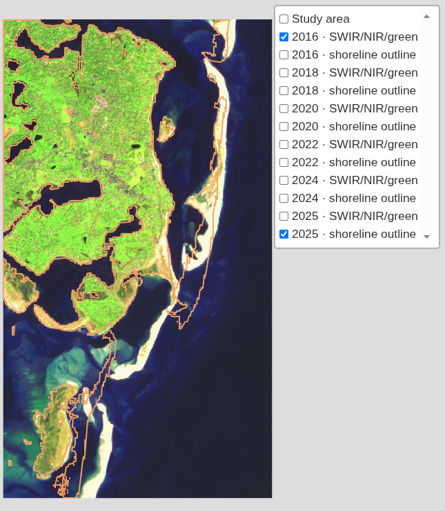
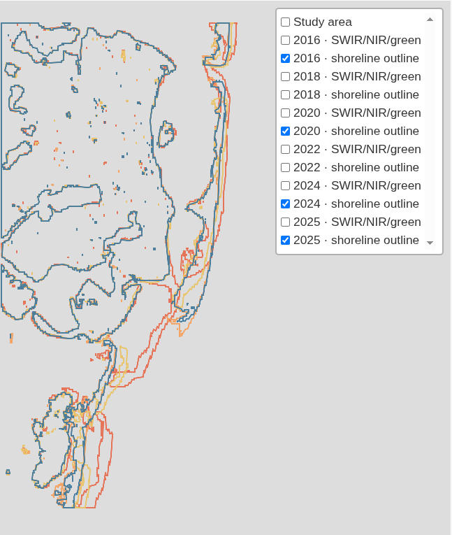
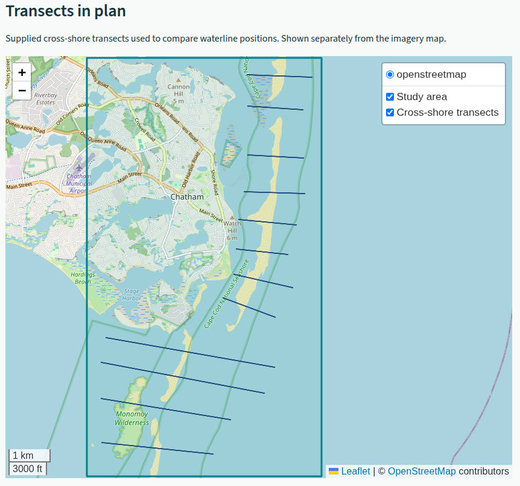
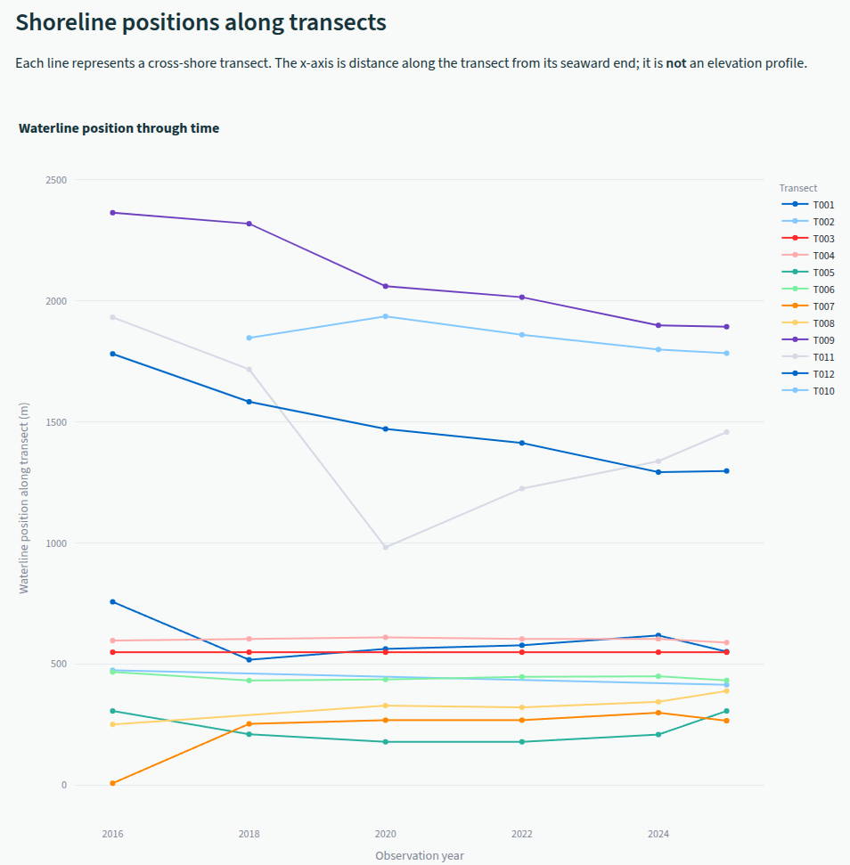
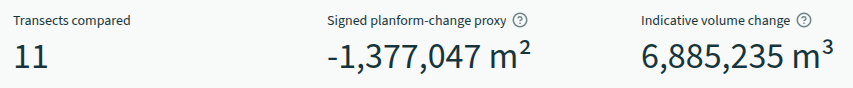

# Coastal Shoreline Change Toolkit

An interactive, form-based demonstration of coastal shoreline change, built with Python and
Google Earth Engine (GEE). It turns Copernicus Sentinel-2 surface-reflectance imagery into
annual shoreline outlines, cross-shore waterline comparisons and a clearly qualified
screening estimate of planform change — starting from a supplied Cape Cod study area and
extending to any uploaded or drawn study polygon.

The water delineation approach here echoes the multi-sensor water-mapping research published in O'Grady, Leblanc & Bass (2014), [*The use of radar satellite data from multiple incidence angles improves surface water mapping*](https://doi.org/10.1016/j.rse.2013.10.006).

This repository shows how a Python-driven pipeline —
cloud masking, temporal compositing, shoreline extraction, projected transect geometry and
change summarisation, all orchestrated in code — delivers reproducible coastal monitoring
outputs from freely available satellite data. Nothing here is filled in by hand or clicked
together in a desktop package: the same workflow reruns end to end on any qualifying study area.

## Why shoreline change matters — and why satellite monitoring

Coastlines are dynamic boundaries shaped by waves, tides, storms, currents, sediment supply
and human activity. Beaches and dunes can retreat or build out between seasons and during
individual storms. Measuring those changes helps coastal communities, councils and researchers
understand shoreline trends, identify vulnerable places, assess how beaches and barriers
respond to storms, and make better-informed decisions about habitat, infrastructure and
coastal planning. No single satellite observation tells the whole story: repeat observations,
honest uncertainty and local context are essential.

Cape Cod is the demonstration site because its exposed Atlantic shoreline, long sandy beaches,
dunes and barrier features make it a compelling setting for observing waterline variability.
Its varied coastal forms are also a deliberate reminder that one index threshold or transect
orientation will not work equally well everywhere — which is why the toolkit lets you adjust
the inputs rather than hiding the choices.

## What the toolkit produces

The toolkit turns selected Sentinel-2 years into annual median image composites,
SWIR/NIR/green false-colour views and annual shoreline outlines. Cloud, cloud-shadow, cirrus,
snow, no-data and defective pixels are masked before the median is calculated; the reducer
ignores masked values, and locations with no clear observation that year remain masked. No
values are filled from other years.

Results are presented so they can be inspected rather than taken on trust:

- The study-area map (Section 2) uses OpenStreetMap for orientation; the imagery results map
  (Section 4) omits the basemap so the shoreline outlines are easier to inspect, while the
  separate transect plan map includes OpenStreetMap.
- Resulting maps show a different-coloured, unfilled vector shoreline outline for each
  observation year, with the colour key beside the imagery map.
- A separate plan map shows the cross-shore transects used to compare waterline positions in
  metres along each transect on a linear scale.
- Transect results download as CSV and GeoJSON, so numbers can be checked independently of the app.

Together, these views support an accessible first look at where the visible waterline has
shifted, how that signal varies along the study area, and how results compare between
selected years.

> **Interpret results with care.** Optical imagery detects a waterline proxy, not a
> datum-corrected shoreline. Tides, waves, season, clouds and the selected water-index
> threshold can all affect the result. The volume figure is an assumption-based screening
> estimate, not a measured sediment budget. This toolkit is intended for exploration and
> communication — not as a substitute for tide-corrected shoreline mapping, field surveys or
> a validated sediment budget.

That qualification is the point, not a disclaimer: monitoring outputs are only useful when
their assumptions are visible and their limits are stated. The same standard applies to
client work — analysis should be traceable, defensible and reproducible.

## Features

- Guides users through Earth Engine setup before they start an analysis.
- Includes the Cape Cod GeoJSON study area; also accepts uploaded GeoJSON or a polygon drawn on the map.
- Builds annual, cloud-masked Sentinel-2 median composites at a selectable interval, every
  two years by default.
- Shows SWIR/NIR/green false-colour imagery and year-coloured, unfilled vector shoreline
  outlines.
- Places the annual shoreline-colour key beside the imagery map.
- Uses the supplied 12 transects for the default Cape Cod study; custom study areas use
  generated transects. A separate plan-view map shows the lines used.
- Compares waterline crossings along projected, evenly spaced transects and provides CSV and
  GeoJSON downloads.
- Optionally samples a local, projected GeoTIFF DEM to display static elevation profiles
  along the same transects.
- Calculates a signed planform-change proxy and a clearly qualified volume estimate using a
  user-supplied active-profile height.

## Example outputs

The screenshots below show example views from the app using the Cape Cod study area. They
illustrate the study-area selection, Sentinel-2 imagery and annual shoreline vectors, the
supplied transects, and the transect-based summaries.

### Select and inspect the study area



The polygon defines the area processed by Earth Engine. Users can keep this default area,
upload another GeoJSON polygon, or draw an area on the map.

### Compare imagery and shoreline outlines



The false-colour composite provides image context for a year-specific, unfilled shoreline
vector. Use the map layer control to switch observation years and compare outlines.



The overlay shows annual shoreline outlines in distinct colours so their positions can be
compared without opaque land-mask fills.

### Inspect transects and waterline positions



The default Cape Cod analysis uses the supplied cross-shore transects. The separate plan view
makes their orientation and coverage visible.



Each line tracks the detected waterline position along one transect across the selected
observation years. This is a linear distance measure, not an elevation profile.

### Review the indicative volume summary



The displayed volume is a screening estimate based on planform change and the user-supplied
active-profile height; it is not a measured sediment volume.

## Requirements

- Python 3.10 or newer (the supplied `.venv` uses Python 3.12).
- A Google account with access to Google Earth Engine.
- A Google Cloud project with the Earth Engine API enabled.

## Set up a clone

From the project directory, create and activate a virtual environment, then install the
project dependencies:

```bash
python -m venv .venv
```

Linux or macOS:

```bash
source .venv/bin/activate
```

Windows PowerShell:

```powershell
.venv\Scripts\Activate.ps1
```

Install the requirements and the local package:

```bash
python -m pip install --upgrade pip
python -m pip install -r requirements.txt
python -m pip install -e .
```

## Connect to Earth Engine

1. Enable the Earth Engine API for a Google Cloud project and note its project ID.
2. With the virtual environment active, authenticate in the same terminal:

   ```bash
   earthengine authenticate --auth_mode=localhost
   ```

3. Start the app:

   ```bash
   streamlit run app.py
   ```

4. Enter the Cloud project ID in the app and select **Verify Earth Engine connection**.

The app uses the Earth Engine credentials configured for the current user. It does not store
service-account keys or credentials. Optionally set `EE_PROJECT` before launching Streamlit
to prefill the project ID.

## Run an analysis

1. Authenticate and verify the Earth Engine connection.
2. Keep the included Cape Cod area, upload a GeoJSON Polygon/MultiPolygon, or select
   **Draw polygon on map** and draw the study boundary. GeoJSON coordinates must be
   longitude/latitude (EPSG:4326); the maximum area is 500 km².
3. Select observation years from 2016 onward and the interval. The default interval is two
   years. The app builds one annual median composite per selected observation year after
   masking cloudy pixels.
4. The default Cape Cod study uses the supplied cross-shore transects in
   `data/transects/transects.geojson`. For uploaded or drawn study areas, set transect
   spacing and the bearing **from sea toward land**.
5. Optionally upload a single-band, projected GeoTIFF to display static elevation transect
   profiles.
6. Select **Run shoreline comparison**. Toggle false-colour imagery and year-specific
   shoreline-outline layers using the map's layer control, then inspect the separate
   transect plan map and download the transect results.

The default AOI is in [`data/aoi/cape_cod.geojson`](data/aoi/cape_cod.geojson). For details
on the index, shoreline proxy, assumptions and limitations, see
[`docs/methodology.md`](docs/methodology.md).

## Project structure

```text
.
├── app.py                       # Streamlit interface
├── data/
│   ├── aoi/
│   │   └── cape_cod.geojson     # Supplied Cape Cod polygon
│   └── transects/
│       └── transects.geojson    # Supplied Cape Cod transects
├── docs/
│   └── methodology.md           # Processing choices and interpretation
├── src/
│   └── coastwatch/
│       ├── analysis.py          # Transects and change estimates
│       ├── config.py            # Shared settings
│       ├── gee.py               # Earth Engine imagery and land mask
│       ├── geometry.py          # AOI validation and transect geometry
│       └── raster.py            # Optional local DEM sampling
├── tests/                       # Local unit tests
├── pyproject.toml
└── requirements.txt
```

## Development checks

```bash
pytest
```

## Data and attribution

Sentinel-2 surface-reflectance scenes are accessed from the
`COPERNICUS/S2_SR_HARMONIZED` Earth Engine collection. The app does not bundle or
redistribute satellite imagery. Respect the applicable Copernicus data terms and Google
Earth Engine terms when using or sharing derived outputs.

## Author

Damien O'Grady is an independent remote sensing and GIS consultant, specialising in Python-driven geospatial pipelines that turn satellite data into decision-ready environmental intelligence.

## License

Released under the [MIT License](LICENSE).

## Reference

**O’Grady, D., Leblanc, M, Bass, A. (2014)**, *The use of radar satellite data from multiple incidence angles improves surface water mapping*. Remote Sensing of Environment, 140, 652–664. [doi:10.1016/j.rse.2013.10.006](https://doi.org/10.1016/j.rse.2013.10.006)
